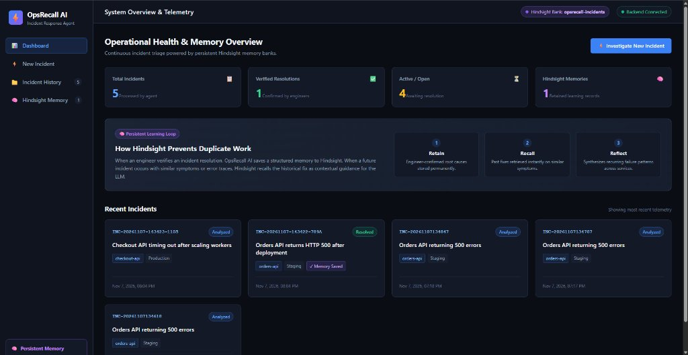

# OpsRecall AI — Intelligent Incident Response with Persistent Memory

[](https://fastapi.tiangolo.com)
[](https://react.dev)
[](https://hindsight.vectorize.io/)
[](https://groq.com)
[](LICENSE)

OpsRecall AI is an AI-powered incident response assistant that analyzes error logs, formulates evidence-based diagnoses, and uses **Hindsight persistent memory** to remember past outages and verified fixes so engineering teams never repeat the same root-cause investigation twice.



---

## 1. Problem Statement

When an application fails, engineers must sift through logs, identify where the failure began, and search old tickets, Slack threads, and forgotten post-mortems for hints on how similar failures were resolved. 

Generic AI chatbots analyze current logs in isolation, but they suffer from **session amnesia**: they have no memory of how the engineering team solved a nearly identical outage last week. This forces engineers to duplicate root-cause investigations and lengthens mean time to resolution (MTTR).

---

## 2. Key Features & Solution Overview

* **Automatic Secret Redaction**: Strips sensitive API keys, JWT bearer tokens, `sk-` keys, database connection strings, and passwords before external LLM or memory transmission.
* **Persistent Memory Loop (Hindsight)**: Uses dedicated memory bank `opsrecall-incidents` to **retain** human-verified resolutions, **recall** past fixes on new incidents, and **reflect** on systemic failure patterns.
* **Cautious Structured AI Diagnosis**: Separates observed facts from candidate hypotheses; recommends read-only, safe investigative checks without executing commands.
* **Multi-Theme Engineering Console**: Includes a live theme switcher (Obsidian Cyan, Emerald Ops, Midnight Synth, Slate Navy), universal Back button, and Sync/Refresh controls.
* **Graceful Local Fallback**: Seamlessly runs with Hindsight Cloud & Groq when keys are present, or uses local SQLite persistent memory and deterministic analysis when offline.

---

## 3. High-Level Architecture

```text
┌────────────────────────────────────────────────────────┐
│                   React 19 Frontend                    │
│                                                        │
│ Dashboard | New Incident | Details | History | Memory  │
└───────────────────────────┬────────────────────────────┘
                            │ REST / JSON
                            ▼
┌────────────────────────────────────────────────────────┐
│                   FastAPI Backend                      │
│                                                        │
│ Routes → Sanitizer → Incident Orchestrator → Agent     │
│                             │                          │
│            ┌────────────────┼────────────────┐         │
│            ▼                ▼                ▼         │
│      Log Parser     Hindsight Service   LLM Client     │
│                             │                │         │
└─────────────────────────────┼────────────────┼─────────┘
                              │                │
                              ▼                ▼
                     Hindsight Memory Bank  Groq API
                        Retain / Recall /   Log Analysis
                            Reflect
                              │
                              ▼
                     Persistent Memory Engine
                              │
                    SQLite Application DB
                   Incident Records & Audits
```

---

## 4. How Hindsight Is Integrated

Hindsight serves as the long-term memory layer of the agent, distinct from the SQLite application database:
- **Bank ID:** `opsrecall-incidents`
- **Retain:** Stores structured incident records (service, environment, symptoms, verified root cause, resolution steps) **only after** a human engineer marks them as confirmed. Unverified hypotheses are never retained.
- **Recall:** Searches the memory bank using natural-language queries synthesized from current incident logs and context.
- **Reflect:** Synthesizes recurring failure patterns across historical incidents.

*Note:* Cloud operations and local SQLite fallback are clearly labeled in the UI (`hindsight_api` vs `local_memory_bank`).

---

## 5. Technology Stack

- **Frontend:** React 19, Vite, responsive dark-mode engineering UI
- **Backend:** Python 3.14+, FastAPI, Pydantic v2
- **Persistent Memory:** Hindsight API (with local persistent fallback engine)
- **LLM Diagnostic Engine:** Groq API (configurable model, e.g. `openai/gpt-oss-120b` or `qwen/qwen3-32b`) with deterministic fallback
- **Storage:** SQLite for application-level metadata and audit history
- **Testing:** Pytest (11 unit & integration tests)
- **Containerization:** Docker & Docker Compose
- **Live Cloud Backend:** [https://opsrecall-backend.onrender.com](https://opsrecall-backend.onrender.com)

---

## 6. Live Deployment & Quick Start

### Live Cloud Endpoints
- **Production Backend API:** `https://opsrecall-backend.onrender.com`
- **Swagger Interactive API Docs:** `https://opsrecall-backend.onrender.com/docs`
- **Health Check:** `https://opsrecall-backend.onrender.com/api/health`
- **Dashboard Telemetry Summary:** `https://opsrecall-backend.onrender.com/api/dashboard/summary`

### Prerequisites for Local Running
- Python 3.10+ installed
- Node.js 18+ and npm installed (or Docker)

### 1. Configure Environment Variables
Copy `.env.example` to `.env`:
```bash
copy .env.example .env
```

Edit `.env` (optional, the application runs fully out-of-the-box in local development mode):
```env
APP_NAME="OpsRecall AI"
APP_ENV=development
BACKEND_HOST=127.0.0.1
BACKEND_PORT=8000

GROQ_API_KEY=your_groq_api_key_here
GROQ_MODEL=openai/gpt-oss-120b

HINDSIGHT_BASE_URL=https://api.hindsight.vectorize.io
HINDSIGHT_API_KEY=your_hindsight_api_key_here
HINDSIGHT_BANK_ID=opsrecall-incidents

DATABASE_PATH=backend/data/opsrecall.db
BACKEND_CORS_ORIGINS=http://localhost:5173
```

### 2. Backend Setup
```bash
cd backend
pip install -r requirements.txt

# Run backend test suite
pytest tests -v

# Start FastAPI server
uvicorn app.main:app --reload --host 127.0.0.1 --port 8000
```
Interactive API documentation is available at `http://127.0.0.1:8000/docs`.

### 3. Frontend Setup
In a separate terminal:
```bash
cd frontend
npm install
npm run dev
```
Open your browser at `http://localhost:5173`.

### 4. Running with Docker Compose
```bash
docker-compose up --build
```
* Backend: `http://localhost:8000`
* Frontend: `http://localhost:5173`

---

## 7. REST API Overview

| Method | Endpoint | Purpose |
| :--- | :--- | :--- |
| `GET` | `/api/health` | Backend and service health check |
| `POST` | `/api/incidents` | Ingest incident, redact secrets, recall memory, generate diagnosis |
| `GET` | `/api/incidents` | Search and filter recorded incidents |
| `GET` | `/api/incidents/{id}` | Fetch full details and resolution for an incident |
| `POST` | `/api/incidents/{id}/resolution` | Save verified resolution and retain into Hindsight memory |
| `POST` | `/api/incidents/{id}/feedback` | Capture engineer feedback |
| `GET` | `/api/dashboard/summary` | Return telemetry metrics (total, resolved, open, memories) |
| `POST` | `/api/memory/recall` | Directly test Hindsight semantic recall |
| `POST` | `/api/memory/reflect` | Directly test Hindsight cross-incident reflection |

---

## 8. Demo Flow: The Dual-Incident Test

OpsRecall AI includes 1-click sample demo buttons directly in the UI:

1. **Submit Scenario A (Orders API 500):**
   - Click **New Incident** → Click **Scenario A (Orders API 500)** → Click **Investigate Incident with AI**.
   - Notice that **Related Past Incidents** is initially empty.
   - In the **Resolution Feedback** section, click **Fill Demo Resolution** and then click **Save Verified Resolution & Retain in Hindsight**.
   - The verified resolution is permanently retained into Hindsight.

2. **Submit Scenario B (Checkout API Timeout):**
   - Click **New Incident** → Click **Scenario B (Checkout Timeout)** → Click **Investigate Incident with AI**.
   - **The Memory Loop in Action:** Notice the purple **Hindsight Recall Active** card at the top!
   - Scenario A's verified fix is retrieved as context, directing the investigation to connection pool settings and worker concurrency.

3. **Explore Hindsight Memory:**
   - Click **Hindsight Memory** in the sidebar to test natural-language recall queries or trigger cross-incident reflection synthesis.

4. **Automated CLI Demo Verification**:
   You can also verify the entire retain $\rightarrow$ recall flow from the terminal:
   ```bash
   python scripts/verify_demo.py
   ```

---

## 9. Testing Instructions

Run the automated test suite covering log parsing, secret sanitization, Hindsight memory dispatch, and full incident lifecycle:
```bash
# Windows PowerShell
$env:PYTHONPATH="backend"; pytest backend/tests -v

# Linux / macOS
PYTHONPATH=backend pytest backend/tests -v
```

---

## 10. Limitations & Future Scope

- **Initial Scope:** Analyzes logs and evidence provided by engineers; does not directly execute write operations or restart production servers.
- **Safety First:** Read-only safe checks are suggested; human verification is strictly required before retaining learning.
- **Future Improvements:** Direct Datadog / Prometheus / AWS CloudWatch telemetry ingestion, automated Slack / PagerDuty bot integrations, and automated runbook generation.

---

## 11. References & Credits

- [Hindsight Documentation](https://hindsight.vectorize.io/)
- [Hindsight GitHub Repository](https://github.com/vectorize-io/hindsight)
- [Groq API](https://groq.com/)
- [FastAPI](https://fastapi.tiangolo.com/)

---

## 12. License

Distributed under the [MIT License](LICENSE).
